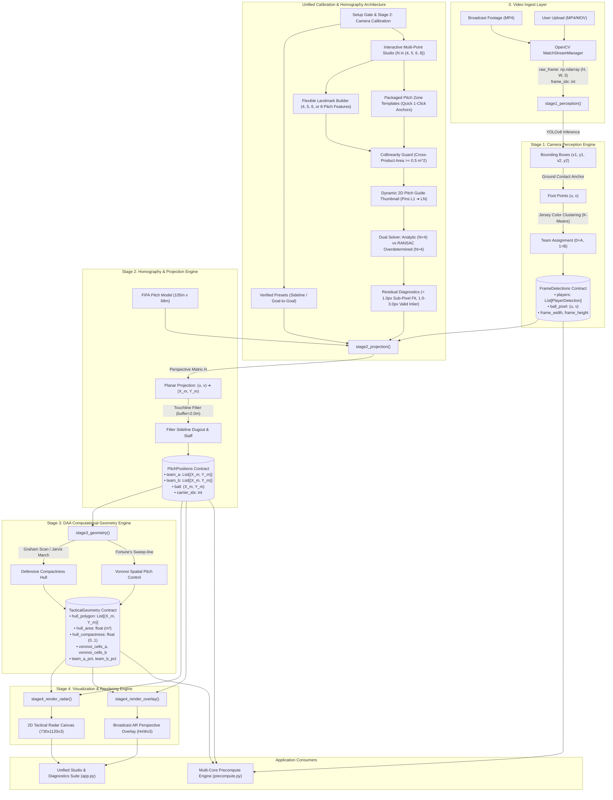

# 📐 Tactical Vision Pro: End-to-End System Architecture

This document defines the complete technical architecture, data contracts, mathematical models, stage inputs/outputs, algorithmic complexities, and execution modes of the **Tactical Vision Pro** platform.

---

## 1. High-Level Architecture & Pipeline Topology

The platform is strictly organized around a 4-stage decoupled contract pipeline with a unified calibration gate. Each stage accepts a strongly-typed contract and produces an immutable downstream contract.



---

## 2. Standardized Data Contracts

All stage interfaces are formalized in `core/contracts.py`:

```python
@dataclass
class PlayerDetection:
    box: Tuple[int, int, int, int]         # [x1, y1, x2, y2] in pixels
    foot_point: Tuple[float, float]        # (u, v) ground contact in pixels
    team_id: int                           # 0: Team A (Sky Blue), 1: Team B (Crimson)
    confidence: float                      # YOLO detection confidence score (0.0 to 1.0)
    class_id: int = 0                      # 0: Player, 32: Sports Ball

@dataclass
class FrameDetections:
    frame_idx: int                         # Timeline frame number
    players: List[PlayerDetection]         # Detected outfield players & goalkeeper
    ball_pixel: Optional[Tuple[float, float]] = None # Ball ground pixel (u, v)
    frame_width: int = 960                 # Frame pixel width
    frame_height: int = 540                # Frame pixel height

@dataclass
class PitchPositions:
    frame_idx: int
    team_a: List[Tuple[float, float]]      # Metric positions (X_m, Y_m) in [0..105]x[0..68]
    team_b: List[Tuple[float, float]]      # Metric positions (X_m, Y_m) in [0..105]x[0..68]
    ball: Tuple[float, float] = (52.5, 34.0)
    carrier_idx: int = 0                   # Index of closest Team A player to ball
    detected_count: int = 0

@dataclass
class TacticalGeometry:
    frame_idx: int
    hull_polygon: List[Tuple[float, float]] = field(default_factory=list) # Defensive perimeter
    hull_area: float = 0.0                 # Defensive block footprint (m²)
    hull_compactness: float = 0.0          # Isoperimetric quotient (0.0 to 1.0)
    hull_vertices: int = 0                 # Count of perimeter players
    hull_player_indices: List[int] = field(default_factory=list) # 1-to-1 map to Team B players
    voronoi_cells_a: List[List[Tuple[float, float]]] = field(default_factory=list)
    voronoi_cells_b: List[List[Tuple[float, float]]] = field(default_factory=list)
    team_a_pct: float = 50.0               # Territory pitch dominance percentage
    team_b_pct: float = 50.0               # Territory pitch dominance percentage
    centroid_team_a: Tuple[float, float] = (52.5, 34.0) # Team mathematical Center of Mass
    centroid_team_b: Tuple[float, float] = (52.5, 34.0)
    latency_ms: float = 0.0
```

---

## 3. Detailed Stage Specifications

### Stage 1: Camera Perception Engine (`stage1_perception`)

* **Purpose**: Ingests raw broadcast video frames and extracts player bounding boxes, foot contact positions, and team assignments using neural network perception.
* **Algorithm**:
  1. **YOLOv8 Deep Learning**: Runs inference on `raw_frame` to detect person (`cls=0`) and ball (`cls=32`).
  2. **Foot-Point Anchor**: Computes bottom-center anchor $u = (x_1 + x_2)/2$, $v = y_2$ as the ground contact coordinate.
  3. **Jersey Color Clustering**: Extracts the player's torso patch (upper 35% of bounding box), masks green turf background, and applies K-Means / HSV histogram distance to classify into Team A vs Team B.
* **Inputs & Parameters**:
  * `frame: np.ndarray`: Array of shape `(H, W, 3)` in BGR format.
  * `detector: FootballDetector`: Model wrapper maintaining YOLO weights.
  * `frame_idx: int`: Integer frame position.
* **Output**: `FrameDetections` contract.
* **Concrete Example**:
  * Input pixel: Player detected with bounding box `[x1=500, y1=300, x2=540, y2=420]`.
  * Foot-point calculated: $u = (500 + 540) / 2 = 520$, $v = 420$ (bottom-center).
  * Color cluster output: Kit sampled in bounding box upper third $\rightarrow$ Neon Blue $\rightarrow$ `team_id = 0`.
* **What is Missing / Known Gaps**:
  * *Player Re-Identification*: Operates frame-by-frame; does not run multi-object tracking (e.g. ByteTrack) to maintain persistent jersey numbers ($P_1 \dots P_{22}$) through camera cuts.
  * *Referee Isolation*: Referees in dark shirts occasionally cluster into Team B.

---

### Stage 2: Spatial Homography & Planar Projection (`stage2_projection`)

* **Purpose**: Maps 2D camera pixels $(u, v)$ onto the standardized FIFA $105\text{m} \times 68\text{m}$ tactical coordinate plane using a calibrated $3 \times 3$ perspective transformation matrix $\mathbf{H}$.
* **Dual-Path Calibration Architecture**:
  1. **Verified Camera Presets**: Pre-calibrated homographies for fixed broadcast camera gantries (`sideline` TV broadcast and `goal_to_goal` tactical end-zone).
  2. **Evolved Multi-Point Landmark Anchor Studio**:
     * **Flexible Multi-Point Builder ($N \in \{4, 5, 6, 8\}$)**: Users select between 4 and 8 visible physical pitch features from the comprehensive `FIFA_CHALK_LANDMARKS` catalog (penalty box corners, penalty arc 'D' apexes, penalty spots, center circle apexes, halfway line touchline marks, and corner flags).
     * **Dual Matrix Solvers**:
       * When $N = 4$: Exact analytical solution via `cv2.getPerspectiveTransform()`.
       * When $N > 4$: Robust overdetermined solution via `cv2.findHomography(src, dst, cv2.RANSAC, 3.0)` with Least-Squares fallback, filtering out human mouse-click jitter and accidental landmark misclicks.
     * **Collinearity Detection Guard**: Evaluates 2D cross-product triangle areas across all triplets $(i, j, k)$. Triangles with area $< 0.5\,\text{m}^2$ trigger a collinearity alert, preventing rank-deficient singular matrix solves.
     * **Reprojection Residual Error Diagnostics**: Back-projects pitch points to camera pixel plane via $\mathbf{H}^{-1}$ and computes Euclidean pixel distance error, displaying live color-coded status badges ($< 1.0\,\text{px}$ Sub-Pixel Fit, $1.0 - 3.0\,\text{px}$ Valid Inlier, $> 3.0\,\text{px}$ Outlier).
     * **Pre-Packaged Pitch Zone Templates**: One-click zone presets (`GROUND_TRUTH_TEMPLATES`) for fast corridor calibration.
     * **Real-Time 2D Pitch Guide Thumbnail**: Dynamically renders the FIFA pitch and highlights the active $N$ targets with ordered pins $L_1 \to \dots \to L_N$ and direction vectors.
     * **Instant Projection Verification**: Overlays full FIFA pitch chalk lines directly onto the calibration frame using candidate $\mathbf{H}$ before confirming.
* **Mathematical Safeguards**:
  * **Collinearity Guard**: `HomographyTransformer.check_collinearity(points)` guarantees no 3 points lie on the same straight line.
  * **Dimension Anchoring**: `transformer.calibrate(src, dst, frame_width=W, frame_height=H)` locks matrix calculations to the active stream resolution, eliminating double-scaling distortions.
  * **Zero-Error Round-Trip Invertibility**: Unclamped raw projection when `filter_out_of_bounds=False` guarantees $< 0.05\text{px}$ round-trip reprojection error ($(u, v) \to (X, Y) \to (u', v')$).
  * **Projective Horizon Protection**: Evaluates homogeneous scale $w = h_{20}X + h_{21}Y + h_{22}$. Points behind the camera horizon ($w \le 10^{-4}$) are discarded to prevent inverted wrap-around polygons.
  * **Dynamic Cache Reprojection**: When manual calibration is applied in cached playback mode, camera foot contacts are dynamically reprojected through $\mathbf{H}$, synchronizing player positions, Convex Hull, and Voronoi territory without re-running YOLO.
* **Mathematical Model**:
  $$\begin{bmatrix} X' \\ Y' \\ W' \end{bmatrix} = \mathbf{H} \begin{bmatrix} u \\ v \\ 1 \end{bmatrix}, \quad X_m = \frac{X'}{W'}, \quad Y_m = \frac{Y'}{W'}$$
* **Touchline Filtering**:
  Excludes dugout coaches, substitutes warming up, and stadium spectators by enforcing:
  $$-2.0\text{m} \le X_m \le 107.0\text{m}, \quad -2.0\text{m} \le Y_m \le 70.0\text{m}$$
  Players within this buffer retain their exact, unclamped coordinate $(X_m, Y_m)$, preserving spatial separation and preventing artificial touchline stacking.
* **Inputs & Parameters**:
  * `detections: FrameDetections`: Stage 1 output contract.
  * `transformer: HomographyTransformer`: Calibrated transformation matrix $\mathbf{H}$.
  * `buffer_meters: float = 2.0`: Touchline buffer margin.
* **Output**: `PitchPositions` contract.
* **Concrete Example**:
  * Foot contact pixel $(u=638, v=294)$ on $960 \times 540$ broadcast screen.
  * Projection matrix $\mathbf{H}$ projects this to $(X_m=65.3\text{m}, Y_m=29.3\text{m})$, matching the player's true position on the pitch.

---

### Stage 3: DAA Computational Geometry Engine (`stage3_geometry`)

* **Purpose**: Pure mathematical tactical analysis using Design and Analysis of Algorithms (DAA) paradigms. Zero machine learning and zero OpenCV dependencies.
* **Algorithms Implemented**:
  1. **Defensive Compactness Hull**:
     * **Graham Scan** ($O(N \log N)$): Sorts defending players radially around the pivot coordinate and uses a stack with orientation cross-products ($\vec{u} \times \vec{v}$) to discard concave vertices.
     * **Jarvis March** ($O(N \cdot H)$): Gift wrapping algorithm that iteratively searches for the most counter-clockwise candidate point.
     * **Metrics Computed**: Shoelace polygon area ($m^2$), perimeter ($m$), isoperimetric compactness $4\pi A / P^2$.
     * **Player Attribution**: Matches hull vertices back to defending player indices via coordinate proximity ($< 10^{-4}\text{m}$).
  2. **Pitch Dominance (Voronoi Tessellation)**:
     * Partitions the metric pitch into polygonal dominance cells via Fortune's sweep-line algorithm ($O(N \log N)$).
     * **Numerically Stable Boundary Clipping**: Implements exact Sutherland-Hodgman axis-aligned boundary clipping against the 4 pitch edges ($x=0$, $x=105$, $y=0$, $y=68$), guaranteeing all cell vertices lie strictly within the pitch turf without floating-point determinant collapse.
     * **Boundary Ghost Mirroring**: Uses 4-sided mirrored ghost sites across field boundaries to enforce closed, bounded Voronoi partitions.
     * **Collinearity Safeguards**: Micro-jitter fallback ($< 0.1\text{mm}$) dynamically prevents Qhull coplanar triangulation crashes when 3 or more players stand in a straight line.
     * Computes territorial control percentages for Team A vs Team B.
* **Inputs & Parameters**:
  * `positions: PitchPositions`: Metric player coordinates.
  * `hull_algo: str`: Algorithm selection (`'graham'` or `'jarvis'`).
* **Output**: `TacticalGeometry` contract.
* **Concrete Example**:
  * Team B coordinates (8 players) input to Graham Scan.
  * Produces a 5-player outer perimeter covering $612.4\text{ m}^2$ with compactness index $0.78$. Voronoi calculates Team A controls $56.3\%$ of the pitch.
* **What is Missing / Known Gaps**:
  * *Kinematic Velocity Vectors*: Current Voronoi uses Euclidean static distance. Pro sports analytics (Spearman model) weights cells by instantaneous player running speed and momentum.

---

### Stage 4: Tactical Visualization & Renderers (`stage4_render_*`)

* **Purpose**: Transforms numerical contracts into broadcast-grade tactical overlays.
* **Sub-Modules**:
  1. **2D Tactical Radar Minimap** (`stage4_render_radar`):
     * Canvas dimensions: $1120 \times 730 \times 3$ with 40px margin padding.
     * Renders dark cyber-tactical pitch template with lawn mower stripes, glowing player nodes, ball vector, Voronoi shaded boundaries, and defensive hull block.
  2. **Broadcast AR Perspective Overlay** (`stage4_render_overlay`):
     * Uses inverse projection $\mathbf{H}^{-1}$ to warp metric geometry directly onto the broadcast camera video.
     * **Full-Perimeter Turf Projection**: Projects the complete pitch boundary $[(0,0), (105,0), (105,68), (0,68)]$ through $\mathbf{H}^{-1}$ to create `turf_mask`, ensuring custom landmark calibrations never clip Voronoi cells to arbitrary sub-quadrilaterals.
     * Renders translucent pitch turf dominance tints, 3D reticles under player boots, and glowing defensive block shields.
* **Inputs & Parameters**:
  * `positions: PitchPositions`
  * `geometry: TacticalGeometry`
  * `raw_frame: np.ndarray` (for AR overlay)
  * `show_voronoi: bool`, `show_hull: bool` (interactive flags)
* **Output**: `radar_canvas: np.ndarray`, `overlay_frame: np.ndarray`.
* **What is Missing / Known Gaps**:
  * *Player Occlusion Masking*: The AR hull fill currently overlays both the grass and player legs. Top broadcast software (e.g. Piero/Vizrt) segments player silhouettes so graphics appear painted directly onto the grass underneath player boots.

---

## 4. Execution Modes Comparison

| Execution Path | Stage 1 (YOLO) | Stage 2 (Projection) | Stage 3 (DAA Math) | Stage 4 (Render) | Latency | Key Benefit |
| :--- | :---: | :---: | :---: | :---: | :---: | :---: |
| **🔬 Unified Studio & Debugger** (`app.py`) | **Cached / Live CPU** | **Live** | **Live** | **Live** | $\sim 1.8\text{ ms}$ (cached) | Comprehensive 6-tab studio: Stage 1-4 contracts, Mouse Calibration Studio, Coach AI, and DAA Benchmarks. |
| **⚡ Multi-Core Precompute** (`precompute.py`) | **Batch (Sequential)** | **Batch** | **Multi-Core Workers (4–8 CPUs)** | *Skipped* | $\sim 15\text{ ms}$ amortized | Serializes full match into indexed JSON cache (`precomputed_*.json`). |

---

## 5. Architectural Invariants & Guardrails

1. **Zero Phantom Players**: Under no circumstances should fallback formations or synthetic player coordinates be injected into pipelines. If fewer than 3 players are detected, `hull_polygon` must be empty `[]`.
2. **Deterministic Frame Locking**: The video decoder (`cv2.VideoCapture`) must strictly read frame $N$ when evaluating metadata for frame index $N$. No loose grab skipping is permitted.
3. **Decoupled Contracts**: Renderers in Stage 4 must never call YOLO detectors or homography matrices directly; they must only consume `PitchPositions` and `TacticalGeometry`.
4. **Coordinate Precision Guarantee**: Planar homography must satisfy $< 0.05\text{px}$ round-trip inversion error $(u, v) \leftrightarrow (X_m, Y_m)$.

---

## 6. Automated Verification Suites

The codebase is protected against regressions and mathematical distortions via three automated verification suites:

1. **End-to-End Coordinate Precision Suite** (`scratch/verify_coordinates.py`):
   - Verifies $< 0.05\text{px}$ round-trip reprojection error across extreme perspective camera points.
   - Verifies touchline buffer retention ($[-2\text{m}, 107\text{m}] \times [-2\text{m}, 70\text{m}]$) and out-of-bounds player filtering.
   - Verifies Voronoi pitch dominance boundary containment ($[0, 105]\text{m} \times [0, 68]\text{m}$).
   - Verifies AR turf mask coverage under custom 4-point landmark calibrations.
   - Verifies end-to-end execution of `run_pipeline_frame()`.

2. **System-Wide Regression Suite** (`scratch/verify_fixes.py`):
   - Validates all 12 core fixes: collinear Qhull handling, timeline slider synchronization, camera mismatch detection, custom calibration parameters, and contract serialization.

3. **Architectural Audit Suite** (`scratch/audit_suite.py`):
   - Validates multi-core worker scaling, clean imports, media dimension synchronization, and contract schemas.
