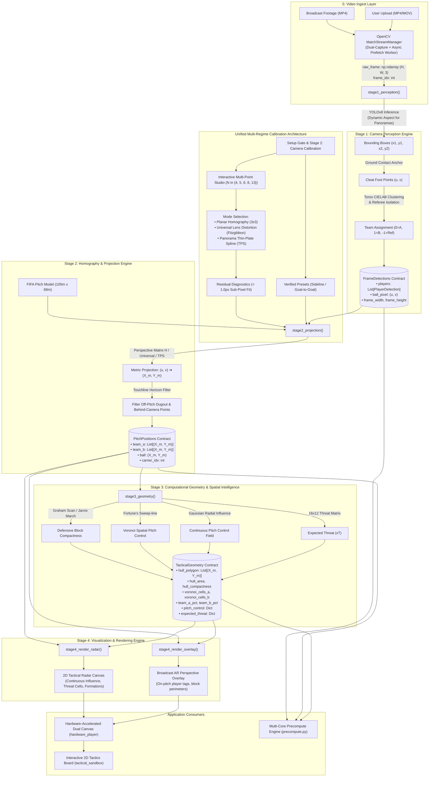

# 📐 TacticalVision Pro: End-to-End System Architecture

This document defines the technical architecture, data contracts, mathematical models, stage inputs/outputs, algorithmic complexities, and execution modes of the **TacticalVision Pro** platform.

---

## 1. High-Level Architecture & Pipeline Topology

The platform is strictly organized around a 4-stage decoupled contract pipeline with a unified multi-regime calibration gate. Each stage accepts a strongly-typed contract and produces an immutable downstream contract.



---

## 2. Standardized Data Contracts

All stage interfaces are formalized in `core/contracts.py`:

```python
@dataclass
class PlayerDetection:
    box: Tuple[int, int, int, int]         # [x1, y1, x2, y2] in pixels
    foot_point: Tuple[float, float]        # (u, v) ground contact in pixels
    team_id: int                           # 0: Team A, 1: Team B, -1: Referee
    confidence: float                      # YOLO detection confidence score (0.0 to 1.0)
    class_id: int = 0                      # 0: Player, 3: Referee, 32: Sports Ball

@dataclass
class FrameDetections:
    frame_idx: int                         # Timeline frame number
    players: List[PlayerDetection]         # Detected outfield players, goalkeepers & referees
    ball_pixel: Optional[Tuple[float, float]] = None # Ball ground pixel (u, v)
    frame_width: int = 1280                # Frame pixel width
    frame_height: int = 720                # Frame pixel height

@dataclass
class PitchPositions:
    frame_idx: int
    team_a: List[Tuple[float, float]]      # Metric positions (X_m, Y_m) in [0..105]x[0..68]
    team_b: List[Tuple[float, float]]      # Metric positions (X_m, Y_m) in [0..105]x[0..68]
    ball: Optional[Tuple[float, float]] = (52.5, 34.0)
    carrier_idx: Optional[int] = 0         # Index of closest possession player to ball
    detected_count: int = 0

@dataclass
class TacticalGeometry:
    frame_idx: int
    hull_polygon: List[Tuple[float, float]] = field(default_factory=list) # Defensive perimeter
    hull_area: float = 0.0                 # Defensive block footprint (m²)
    hull_compactness: float = 0.0          # Isoperimetric quotient (0.0 to 1.0)
    hull_vertices: int = 0                 # Count of perimeter players
    hull_player_indices: List[int] = field(default_factory=list)
    voronoi_cells_a: List[List[Tuple[float, float]]] = field(default_factory=list)
    voronoi_cells_b: List[List[Tuple[float, float]]] = field(default_factory=list)
    team_a_pct: float = 50.0               # Territory pitch dominance percentage
    team_b_pct: float = 50.0               # Territory pitch dominance percentage
    centroid_team_a: Tuple[float, float] = (52.5, 34.0) # Mathematical Center of Mass
    centroid_team_b: Tuple[float, float] = (52.5, 34.0)
    dijkstra_res: Optional[Dict[str, Any]] = None       # Backwards-compatible contract field
    latency_ms: float = 0.0
```

---

## 3. Execution Modes & Performance

TacticalVision Pro supports three unified execution modes:

1. **`Instant Replay (Saved Analysis)`**:
   - High-throughput client playback at 60 FPS utilizing the browser hardware player (`hardware_player.html` / WebGL).
   - Reads serialized frame bundles (`positions`, `detections`, `geometry`) from persistent JSON caches (`data/custom_caches/` or `data/precomputed_user.json`).
   - Zero CPU inference overhead during scrubbing or playback.

2. **`Analyze Full Clip Now (Precomputation)`**:
   - Parallel batch analysis engine using Python's `ProcessPoolExecutor` with configurable CPU workers ($N \in [1, \text{cpu\_count}]$).
   - Computes player detections, kit clustering, foot anchoring, and tactical geometry with an $O(1)$ sampling stride ($S \in [1, 5]$).
   - Automatically saves results to disk for instant future sessions.

3. **`Live Frame-by-Frame Mode`**:
   - Live on-demand pipeline execution as frames are requested.
   - Ideal for interactive calibration tweaking and live camera inspection.
